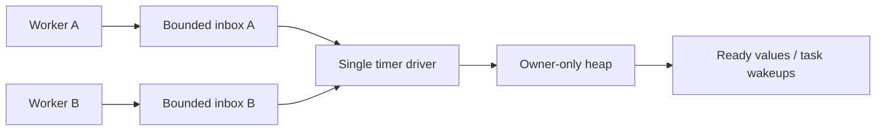

# Timer driver experiment

Per-producer bounded inboxes feeding one heap owner substantially improve concurrent burst throughput in this experiment. They add overhead at low contention, and do not by themselves improve deadline latency. The implementation is available behind the `driver` feature, independently of the scheduler.

The experiment lives on `experiment/timer-driver`, based on timer baseline `5cb3b96`. The original checkout and its executor changes were left untouched. The scheduler clock still uses async-io; this branch supplies a queue and a caller-driven timer owner, not a new sleep future or executor integration.

## Architecture

Each worker owns a `TimerProducer`. Setup allocates a fixed pool of slots, a bounded submission inbox and a free-slot queue. The driver reserves its heap and insertion buffer for the sum of producer capacities. A dedicated external producer can serve submissions from outside the workers; the API requires mutable access, so external callers must serialize access to that producer or own separate producers.



Registration reserves a free slot, stores the payload and publishes its deadline and slot index. Each drain processes at most one inbox capacity, preventing continually refilled cancellation traffic from starving other producers. After draining all inboxes, the driver filters cancelled submissions before admitting them to the heap. The driver batches insertion and selects individual heap pops or one partition/heapify for dense expiry. A notification flag per producer coalesces unparks. The driver resets each flag before draining, preserving a park token for publications that race its transition to sleep.

A handle keeps its original pool alive when a task migrates. Cancellation claims its value immediately, releases it outside synchronization and notifies the driver. A per-pool atomic counts cancelled entries admitted to the heap; admission, cancellation and retirement update membership and counts under the slot mutex. Cancelling a staged submission does not request a scan of the existing heap. Physical reclamation is deferred. The slot becomes reusable only when its queue entry and handle are gone; no stale handle can refer to a reused slot. Dropping a handle leaves its timer scheduled. Handles are not clonable in this prototype.

Following io-event, compaction normally requires at least 128 cancellations and more than half of retained entries to be cancelled. A fully cancelled heap is also reclaimed below that threshold. Cancelled roots are removed on deadline queries. Because producer pools are bounded, a pool with no free slots and at least one heap cancellation forces compaction on the next poll, even below the batching threshold. This allows reclamation and reuse under capacity pressure; outstanding handles still retain their slots. A compaction appends the new batch and repairs the heap once. Atomic count snapshots determine the cleanup policy; slot mutexes determine payload ownership. Cancellations racing a snapshot preserve a notification for another poll.

This is a safe Rust prototype, with no custom unsafe synchronization. Crossbeam's `ArrayQueue` provides fixed-capacity queues. A mutex per slot arbitrates cancellation and delivery, and a separate admission mutex per producer serializes registration against shutdown. There is no shared heap mutex. These locks can still contend when cancellation races expiry, and pool Arc counters/free-slot queues can share cache lines between migrated tasks and the owner. This experiment tests removal of *global* contention; it is not fully lock-free.

The driver binds notifications to its thread on the first poll or deadline query. It can move before binding; polling it on another thread afterwards panics. Dropping it closes each producer under its admission lock, waits for in-flight publications and releases queued values. Outstanding handles remain queryable. Payload destructors run outside slot/admission locks, with cleanup continuing after one destructor panics.

A full producer returns the original value. Capacity cannot be borrowed from another producer. Completed handles and deferred cancellation entries retain capacity. Production integration must choose capacities and a retry/backpressure policy, provide shutdown outcomes for sleeping tasks, and route delivered wakers into the work-stealing scheduler. Timer ownership need not follow task migration.

## Concurrent bookkeeping

The initial prototype at `7d6c8c3` was measured on 2026-10-12, macOS 27.0.1 AArch64, Rust 1.98.1, optimized Cargo bench profile, Crossbeam Queue 0.3.13. The concurrent and parking results below describe that revision, before the cancellation refinement documented in the next section. Each sample registers 10,000 timers per producer. Eleven samples alternate implementation order; values below are median wall-clock nanoseconds per input timer. There are N producer threads and one owner thread in both variants. Pool construction, output reservation, calls to create OS threads, thread joins and queue destruction are excluded. Waiting at the startup barrier is included.

| Producers | Shared burst | Driver burst | Shared cancel half | Driver cancel half |
| ---: | ---: | ---: | ---: | ---: |
| 1 | 63.4 | 67.3 | 47.9 | 49.0 |
| 2 | 75.6 | 33.3 | 59.5 | 28.6 |
| 4 | 119.8 | 26.4 | 96.8 | 24.4 |
| 8 | 118.5 | 23.2 | 98.4 | 23.8 |

At eight producers the driver processes the burst about 5.1× faster, and the cancellation workload about 4.1× faster. One-producer burst processing is about 6% slower. A paced workload sleeps 100 microseconds after each group of 64 submissions; at eight producers its result is 276.7 vs 260.3 ns/input timer, about a 6% improvement. Sleeping dominates that workload. Raw timings and approximate sample 95th percentiles are in [driver.csv](driver.csv).

The baseline uses `Timers::shared_producer`, a registration-only view of the existing shared state. It acquires the existing mutex directly, without a second wrapper mutex. Dropping the owning queue closes these views. Each timer uses the same deadline and `Instant` payload on both sides. Handles are dropped immediately after registration, and cancellation is explicit for every other timer in the cancellation workload. Thus this fixture models fire-and-forget registration and explicit cancellation, rather than a sleep future retaining its handle until completion.

The owner polls and yields while producers submit. Burst delivery uses an explicitly supplied elapsed timestamp, excluding real waiting. In the cancellation fixture, deadlines remain in the future until all producers finish, so exactly half the values are delivered. Assertions verify those counts. Measurements include registration, handle destruction, inbox draining/flushing, reclamation and delivery. They are end-to-end pipeline wall times, not sums of CPU time or isolated registration timings. Poll cadence affects mutex contention and batch sizes; these are not scheduler throughput measurements.

## Cancellation churn refinement

The initial driver already filtered cancelled inbox entries, but every successful cancellation marked its pool dirty and forced an O(n) scan of the existing heap at the next poll. That included timers cancelled before admission. Tracking heap membership and batching cleanup removes that repeated work.

The new `cancellation` benchmark keeps 10,000 earlier timers resident while submitting 64 batches of 1,000 later timers. Each batch cancels 95% or 99% of its timers, drops its handles, and queries the next deadline to flush. The after-admission variant also flushes before cancellation, ensuring those timers really enter the heap. Survivors remain resident until the final delivery. Capacity is reserved for the worst-case total registrations, deliberately avoiding the pressure fallback. Setup, resident registration, caller buffers and destruction are excluded; registration, cancellation, handle destruction, flushing, reclamation and final delivery are included. Times are divided by 64,000 churn registrations, including the final delivery of the 10,000 resident values. This is owner-thread bookkeeping, with no worker contention or elapsed deadline waiting.

Eleven optimized samples alternate the shared queue and driver on the same machine. The same benchmark was first run against `7d6c8c3`, then against the refinement. Separate before/after runs can drift; the shared results are included in [cancellation.csv](cancellation.csv).

| Cancellation | Phase | Initial driver ns/timer | Refined driver ns/timer | Improvement |
| ---: | --- | ---: | ---: | ---: |
| 95% | Before admission | 102.8 | 38.1 | 2.7× |
| 95% | After admission | 110.6 | 48.1 | 2.3× |
| 99% | Before admission | 96.3 | 33.4 | 2.9× |
| 99% | After admission | 104.2 | 48.8 | 2.1× |

The shared queue still wins these owner-thread fixtures: 18.5–22.6 ns/timer in the refined run. It can filter slots while holding one lock, whereas the driver pays for bounded queues, per-slot locking and pool reference counts without benefiting from reduced global contention here. The before/after measurements do not establish scheduler throughput. Dense resident tombstones are reclaimed in batches; sparse ones can retain capacity until root removal or the pressure fallback. The regression and allocation tests cover that fallback and subsequent reuse.

## Tokio cancellation comparison

The cancellation benchmark now also measures Tokio 1.53.2 with the same resident count, batches, cancellation ratios and deadline offsets. Eleven optimized samples rotate among the shared queue, refined driver and Tokio. Results are median ns/churn timer, including final delivery:

| Cancellation | Phase | Shared queue | Driver | Tokio |
| ---: | --- | ---: | ---: | ---: |
| 95% | Before admission | 20.0 | 34.7 | 12.3 |
| 95% | After admission | 22.9 | 47.1 | 29.4 |
| 99% | Before admission | 18.4 | 32.2 | 9.4 |
| 99% | After admission | 23.1 | 48.0 | 29.7 |

At 99% cancellation the driver is about 3.4× slower before admission and 1.6× slower after admission. The shared queue is about 22% faster than Tokio after admission, but about 2× slower before admission. Raw results are in [tokio-cancellation.csv](tokio-cancellation.csv). These are a fresh run rather than figures spliced into the earlier before/after experiment.

Tokio uses a paused current-thread runtime constructed outside timing. Storage for all `Option<Sleep>` entries is reserved in one fixed-length pinned slice before timing, avoiding a box or allocation per timer. Resident sleeps are constructed and polled outside timing. In each timed batch, the benchmark constructs sleeps, polls all of them before cancellation in the after-admission case, destroys cancellations in place, and polls only survivors in the before-admission case. A reserved list tracks live entries, so final delivery does not scan previously cancelled slots. This list and the output buffer are reserved outside timing. Survivors remain pinned until destruction. Tokio cancellation deregisters through pinned destruction; Socketry cancellation uses its explicit handles and flushes deferred reclamation.

Final delivery includes advancing paused Tokio time by 120 seconds plus one millisecond for deadline rounding, driving its public timer service with a zero-duration sleep, polling all surviving futures to confirm readiness, and collecting their deadlines. Socketry receives an explicit elapsed timestamp and collects `Instant` payloads. Setup and final destruction are excluded for all three variants. This measures their different public API and storage costs; it does not make the independent queue equivalent to a complete sleep future or compare work-stealing runtimes, wakeup latency or multithreaded contention.

The remaining driver cost is consistent with its producer inbox, slot locks, free-slot queue and reference counting, which this owner-thread workload pays without a contention benefit. Tokio also avoids registering sleeps cancelled before their first poll. The benchmark does not isolate these costs individually; a profile would be needed to attribute the difference precisely.

## Real deadlines and parking

A separate test schedules timers two milliseconds after each actual submission and waits using `thread::park`/`park_timeout`. Sparse producers sleep one millisecond between timers; burst producers submit continuously. Three trials are pooled for latency percentiles, with 100 sparse or 1,000 burst timers per producer per trial. Both implementations use per-producer coalesced notifications; the benchmark supplies that notification adapter to the shared queue, which has no built-in wait protocol. Delivery latency is measured after polling returns, so it includes batch collection cost.

| Eight producers | Shared p50 lateness | Driver p50 lateness | Shared p99 lateness | Driver p99 lateness |
| --- | ---: | ---: | ---: | ---: |
| Sparse | 56.8 µs | 61.2 µs | 180.3 µs | 188.7 µs |
| Burst | 5.7 µs | 526.0 µs | 81.7 µs | 574.7 µs |

The burst difference needs context: median submission span was 2,672.9 µs for the shared queue and 98.7 µs for the driver. The owner invoked its park method 400 vs 2 times respectively; an invocation can consume an existing token immediately, so these counts do not measure time asleep. Slower shared submissions kept arriving around the deadlines, whereas the driver completed ingestion well before the deadlines. The results are consistent with fast ingestion allowing an idle park and exposing OS timed-wakeup delay, while continued submissions keep the slower implementation active. This is an inference from the timing and park-call measurements, not a CPU profile or proof of one underlying OS mechanism.

Sparse latency is similar, and burst latency varies with producer count and scheduling. Throughput improvements do not imply better wakeup latency or lower CPU consumption. A production wait policy may need controlled spinning near deadlines or an I/O poller with suitable timeout behavior; those policies require separate CPU/latency measurements. No such policy is implemented here. These measurements come from one development machine without affinity or CPU isolation, and latency fixtures run the shared variant before the driver. Rerun on deployment platforms before choosing a scheduler design.

## Allocations and costs

The allocation fixture uses one pool with 10,000 slots and no-op wakers, measuring setup separately from operations:

| Operation | Allocation calls | Cumulative requested bytes |
| --- | ---: | ---: |
| Shared queue setup | 5 | 1,120,208 |
| Driver pool/heap setup and thread binding | 10,008 | 2,161,120 |
| Driver registration, cancellation and reclamation | 0 | 0 |
| Driver reuse, bulk expiry and delivery | 0 | 0 |

Caller handle/output vectors are reserved outside these windows. Requested bytes are not peak memory. On macOS, each standard mutex lazily allocates native storage; this prototype initializes all slot locks during pool setup. Consequently it makes no per-registration allocations, but setup has an allocation per reserved slot. This is a significant memory/setup regression from the shared arena and must be considered alongside throughput. Raw counts are in [driver-allocations.csv](driver-allocations.csv).

The most useful next improvements are an inline atomic claim protocol for slot payload ownership (with a reviewed lifetime proof) and a cheaper SPSC submission ring. Cancellation compaction is now batched, but capacity pressure can still force a whole-heap scan for a sparse cancellation in one full producer pool. An indexed heap or bounded cancellation-command ring could make that reclamation more selective; neither is evaluated here. The free-slot return path has multiple writers and cannot simply become SPSC.

The evidence supports per-worker ingress as an option when contention is significant. It does not establish that a dedicated owner thread is best at low load, that this is better than per-worker timer heaps, or that it beats Tokio's multithreaded runtime. The existing [Tokio comparison](benchmarks.md) measures different single-thread bookkeeping fixtures. The driver experiment deliberately compares the proposed ingress design with the same Socketry shared queue first.

## Validation and reproduction

Both default and experimental feature configurations passed the Bake coverage gate: 571/571 and 1048/1048 measured source regions respectively, on local macOS AArch64. Experimental checks include 41 unit tests, two allocation regression tests, five benchmark smoke programs and four doctests. Tests exercise fixed capacity and reuse, migration, cancellation/expiry races, cancellation during inbox draining, compaction thresholds, capacity pressure, empty/earlier-deadline wakeups, shutdown racing admission, destructor reentry and panic cleanup. A Loom model checks the two-publication/coalesced-notification protocol; it does not model the entire queue, heap or Crossbeam implementation. Clippy passes with warnings denied.

```sh
cargo bench -p socketry-timers --features driver --bench driver --locked
cargo bench -p socketry-timers --features driver --bench cancellation --locked
cargo bench -p socketry-timers --features driver --bench allocations --locked

env CARGO_TARGET_DIR=target/timers-coverage \
  rustup run stable cargo bake test:coverage \
  --package socketry-timers --all-features true --all-targets true

env CARGO_TARGET_DIR=target/timers-default-coverage \
  rustup run stable cargo bake test:coverage \
  --package socketry-timers --all-targets true
```
