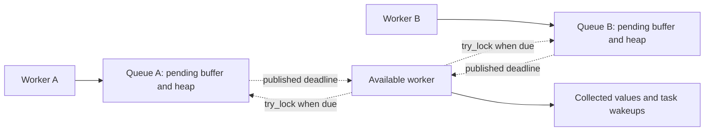

# Worker timer queues and lazy sleeps

The `sharded` feature provides independent worker queues with nonblocking cross-worker assistance. It retains io-event's pending-buffer and binary-heap strategy and avoids the inbox driver's per-slot mutexes and submission/free-slot queues. The crate remains independent of the scheduler.

The experiment is on `experiment/timer-driver`, based on `0fdf240`, in `/private/tmp/socketry-rust-timer-driver`. It supplies queues, assistance views, an idle-thread waiter and a lazy sleep future. Executor integration remains a separate step.

## Ownership and assistance

Each `WorkerTimers<Value>` owns an arena, unordered pending buffer and binary heap. Registration, remote cancellation and expiry use one mutex per queue. Cancellation releases its value outside synchronization; queue entries are reclaimed during flushing, compaction or root removal. Completed handles retain their slots until their final clone is dropped.



Scheduling publishes a conservative atomic deadline hint before returning, including registrations still in the pending buffer. Earlier hints notify registered waiters. Polling repairs the queue and updates its hint under the same queue mutex, so writers need no global atomic minimum or global timer heap. Cancelled hints can cause an early visit. Fully cancelled or capacity-constrained queues request immediate cleanup; capacity pressure can force compaction below the ordinary 128/majority threshold.

A `TimerAssist` retains the original queue. Helpers read its hint without locking, then use `try_poll` to collect due values. A busy queue returns `None`; the helper can visit other queues. Output capacity bounds delivery count, and caller-reserved output storage is reused. Values are claimed under the queue lock and processed after returning. Values need only be `Send` for cross-thread use. Handles retain their original identity after task migration, and cancellation and expiry claim each value at most once.

Assistance is opportunistic: there is no heartbeat or explicit stall detector. An available worker may service a due queue while its owner is otherwise occupied. Healthy owners normally service their own queues. No timer migration or transfer of heap ownership is required.

`TimerWaiter` registers a thread's unpark handle with several queues during setup. Its `park` method scans their published hints and waits until the earliest deadline, an earlier publication, shutdown or a spurious wake. Publishing before unparking and preserving park tokens prevents an insertion racing the transition to sleep from being lost. Empty open queues can park indefinitely; an empty or entirely closed watched set returns immediately. Dropping the waiter unregisters it.

Deadline hints encode nanoseconds relative to queue construction. Historical deadlines become an immediately due hint; deadlines beyond the representable range are advertised earlier. Actual queue comparisons retain `Instant` precision. Queue state and publication allocations have 128-byte alignment to separate worker metadata on this machine. This costs padding once per queue. Standard mutexes can also allocate native storage during setup.

## Lazy sleep futures

Use `WorkerTimers<SleepWake>` and create sleeps through its assistance view's `sleep_until` method. An unpolled sleep stores its deadline and one shared queue reference. Construction and destruction perform no queue locking, slot reservation, pending insertion or deadline publication. The future is `Unpin` and requires no separate allocation.

The first poll registers its waker and publishes the deadline. The future keeps its original queue reference and a generation-checked slot key directly, without constructing a cloneable `TimerHandle` or incrementing the queue reference count again. Subsequent polls update the waker under the existing queue lock; user waker clone/drop callbacks run outside the lock. Dropping the future cancels its registration, disarms the stored wakeup and releases its slot reference under one lock. Completion checking also releases the slot reference under that same lock, then releases the queue reference. Cancellation before flushing skips heap insertion. Collection returns `SleepWake` values; dropping them outside timer operations wakes tasks. The future observes completion through its retained arena slot.

Owner shutdown closes admission and drops queued wakeups outside locks. Registered sleeps wake and resolve with `SleepError::Closed`. An unpolled sleep observes shutdown on its first poll. Shutdown takes precedence until a sleep has been polled to completion; completed results are stable. First polling a full queue returns `SleepError::Full`, without growing storage or waking the rejected task. Caller-driven polling is required even for deadlines already in the past.

Lazy registration benefits sleeps that are dropped before first polling, such as a timeout branch an operation completes before reaching. Once an I/O operation remains pending and its timeout is polled, a real timer registration is still necessary. Later cancellations retain the buffered-admission and batch-compaction benefits.

## Concurrent throughput

Measured on 2026-10-13, macOS 27.0.1 AArch64, Rust 1.98.1, optimized Cargo bench profile. Each worker registers 100,000 timers. Eleven samples rotate among the global shared queue, inbox driver, worker-local queues and worker-local queues with one registered observer. Results are median wall-clock nanoseconds per input timer.

| Workers | Shared burst | Inbox burst | Local burst | Watched local burst | Shared 99% cancel | Inbox 99% cancel | Local 99% cancel | Watched local 99% cancel |
| ---: | ---: | ---: | ---: | ---: | ---: | ---: | ---: | ---: |
| 1 | 30.9 | 37.2 | 20.1 | 20.0 | 34.0 | 65.1 | 20.3 | 20.3 |
| 2 | 55.1 | 31.6 | 10.7 | 11.1 | 69.6 | 18.0 | 10.2 | 10.2 |
| 4 | 153.8 | 34.2 | 15.0 | 27.7 | 155.8 | 14.6 | 15.0 | 18.4 |
| 8 | 175.7 | 36.2 | 21.9 | 20.4 | 150.3 | 13.7 | 14.4 | 14.4 |

At eight workers the watched local burst is about 1.8× faster than the inbox driver and 8.6× faster than the global queue. At 99% cancellation it roughly matches the inbox driver and is about 10.4× faster than the global queue. Scaling is uneven, with appreciable variation in some cases. Raw medians and approximate sample 95th percentiles are in [sharded.csv](sharded.csv).

Worker-owned queues and output storage are constructed on their worker before timing. Shared queue and producer pools are constructed before producer startup. Calls to create threads, reservation, joins and queue destruction are excluded. Waiting at the startup barrier is included. Global variants use N producers and one polling coordinator; the local variants use N owners and a coordinator observing completion. Each local owner polls every 64 registrations. The watched variant registers one observer with every queue and pays notification costs; that observer does not collect timers while owners are healthy.

The burst uses an explicitly elapsed timestamp for collection. In the cancellation workload, 99 of each 100 submissions are cancelled immediately and deadlines remain in the future during ingestion. Final polling delivers survivors. Assertions check delivery counts. These fixtures compare architectural throughput, including differing polling cadence, batches and service roles. They do not isolate registration cost or compare multithreaded Tokio runtime throughput.

Initial 10,000-timer samples varied sharply. Inspection found several unrelated Clippy processes consuming cores; the final run used longer samples after most of that compilation finished. A background Clippy process was still observed. This development machine has no CPU isolation or affinity controls, and the results should be repeated on deployment hardware. Padding effects have not been isolated by a profile.

## Stalled-owner latency

The owner registers 1,000 timers due two milliseconds later, leaves them unflushed, then sleeps for a requested 20 milliseconds. Three trials are pooled. With assistance, another thread uses the published hint and waiter to collect the timers. Both owner and helper deliveries are included, so the fixture remains correct if the helper itself is delayed. It verifies the total delivery count.

| Assistance | p50 lateness | p99 lateness | Maximum lateness |
| --- | ---: | ---: | ---: |
| Disabled | 23,037.7 µs | 23,046.0 µs | 23,046.0 µs |
| Enabled | 511.4 µs | 518.9 µs | 518.9 µs |

The helper services pending registrations before owner resumption. Measured lateness includes OS timed-wakeup delay and batch collection. The owner's requested sleep can last longer than 20 ms because of OS scheduling and timer coalescing. This is a correctness and latency demonstration with an available helper, rather than a scheduler latency guarantee.

## Cancellation and Tokio

The cancellation benchmark keeps 10,000 earlier timers resident, then processes 64 batches of 1,000 later timers with 95% or 99% cancellation. The before-admission queue fixture cancels before flushing. The after-admission fixture flushes before cancellation. Storage, resident initialization, runtime setup and destruction are excluded; final delivery is included. Eleven samples rotate implementations in each run. The table reports the median of the medians from three runs with direct slot ownership. Tokio 1.53.2 uses its paused current-thread runtime and fixed pinned storage for sleeps.

The eager queue's before-admission fixture already reserves slots and appends pending entries. Tokio's unpolled sleeps do no queue registration. The lazy sleep fixture now measures that same first-poll distinction: cancelled futures are destroyed without polling, and only survivors register. After admission, all futures are polled and all Socketry registrations are flushed before cancellation. Fixed future storage, output and live-index buffers are reserved before timing. Final delivery includes real wakeup processing and polling surviving futures for readiness.

| Cancelled | Phase | Shared queue | Inbox driver | Eager worker queue | Lazy sleep | Tokio sleep |
| ---: | --- | ---: | ---: | ---: | ---: | ---: |
| 95% | Before admission | 19.9 | 33.0 | 21.3 | 7.0 | 11.6 |
| 95% | After admission | 24.6 | 48.0 | 26.3 | 26.5 | 30.3 |
| 99% | Before admission | 19.8 | 33.2 | 21.2 | 6.0 | 10.0 |
| 99% | After admission | 24.6 | 48.8 | 26.4 | 26.5 | 29.6 |

Values are nanoseconds per churn input, including final resident delivery. At 99% cancellation before first polling, lazy sleep is about 3.5× faster than the eager worker queue and 40% faster than Tokio. After admission it is about 10% faster than Tokio; the 95% case is about 13% faster. Lazy creation and destruction still retain/release a shared queue reference. Registered futures maintain a slot reference and waker, poll completion and release the slot reference.

The previous handle wrapper at commit `93fb81f` took 32.9 ns/input after admission in a baseline rerun immediately before this change. Direct slot ownership took 26.4–26.5 ns/input at 95% cancellation and 26.2–27.0 at 99%, about 18–20% less time. It removes an Arc increment/decrement pair at admission and combines the previous two lock acquisitions on cancellation and completion into one. It also avoids storing the handle's redundant deadline. These changes were measured together; no profile isolates their individual contributions. The results remain single-thread bookkeeping measurements on a development machine, rather than a claim about executor throughput.

Results are in [sharded-cancellation.csv](sharded-cancellation.csv); the baseline and three direct-slot run medians are in [sharded-sleep-lifecycle.csv](sharded-sleep-lifecycle.csv). The independent queue still differs from a full sleep future: its expiry returns payloads directly. Compare the lazy-sleep column with Tokio when assessing future lifecycle costs. The Tokio driver is advanced through its public timer service; Socketry is driven with an explicit elapsed timestamp. This comparison measures bookkeeping rather than real-time deadline latency or a full executor.

## No-cancellation lifecycle

The same benchmark also has a zero-cancellation control: 64 batches of 1,000 timers, no pre-existing resident timers, and all 64,000 timers firing at a shared deadline. Socketry flushes each registration batch, then collects the entire queue in one expiry call. Every sleep is constructed, polled to register, woken through a no-op waker, polled to completion and destroyed inside timing. Queue/runtime setup, fixed future storage, caller-buffer reservation and final buffer/queue teardown are excluded. Tokio uses the same paused current-thread runtime and pinned storage as the cancellation cases.

Three runs each rotate implementations over eleven samples. The table reports the median of their medians in nanoseconds per timer:

| Implementation | ns/timer |
| --- | ---: |
| Shared payload queue | 22.7 |
| Inbox payload driver | 50.5 |
| Eager worker payload queue | 24.5 |
| Lazy worker sleep | 30.1 |
| Tokio sleep | 42.5 |

The comparable sleep futures take 29.8–30.8 ns/timer for Socketry and 42.1–43.4 for Tokio across the three runs: about 29% less time for Socketry. The eager queues deliver values without polling a future for completion, so they expose queue cost rather than equivalent sleep lifecycle cost. Compared with the cancellation cases, this control includes completed-future destruction inside timing on both sides and excludes resident timers entirely.

This is dense bulk expiry. Socketry filters the heap once when every timer is due, avoiding repeated heap repair. It does not establish the same advantage for staggered deadlines, small expiry batches, task scheduling, contention or real-time wakeup latency. No profile separates registration, expiry, completion and destruction costs. Raw run medians are in [sharded-no-cancellation.csv](sharded-no-cancellation.csv). Reproduce with:

```sh
cargo bench -p socketry-timers --all-features --bench cancellation --locked -- --no-cancel
```

## Cancellation sweep

The `--cancellation-sweep` mode extends the complete future lifecycle control to 0%, 10%, 50%, 90% and 100% cancellation. Every row has 64 batches of 1,000 input timers and no resident timers. Every future is first polled to register; Socketry flushes each batch before cancellation. The selected prefix of each batch is destroyed to cancel it. Remaining timers expire together at a shared deadline, run no-op wakeups, are polled to completion and are destroyed inside timing. Output counts are checked against the cancellation percentage, including zero survivors at 100%.

Setup and fixed storage reservation are excluded, and timings are divided by all 64,000 input timers, including cancellations. Tokio 1.53.2 uses paused time and pinned storage. The table reports the median of three run medians, each from eleven samples with rotating implementation order:

| Cancelled after registration | Worker sleep ns/input | Tokio sleep ns/input | Time saved |
| ---: | ---: | ---: | ---: |
| 0% | 28.0 | 40.8 | 31.4% |
| 10% | 27.3 | 40.1 | 31.9% |
| 50% | 25.2 | 34.8 | 27.6% |
| 90% | 24.3 | 28.2 | 13.8% |
| 100% | 21.4 | 26.9 | 20.4% |

Time saved is `1 - worker / Tokio`. At 100% Socketry can clear each fully cancelled heap after its batch instead of retaining a resident heap. These rows share a consistent timing window; they differ from the earlier 95%/99% fixtures, which keep 10,000 resident timers and exclude surviving-future destruction. The 0% row reruns the no-cancellation control above; absolute timings vary between invocations on this development machine. These results cover single-thread bookkeeping and dense survivor expiry, without task scheduling or contention. Raw run medians are in [sharded-cancellation-sweep.csv](sharded-cancellation-sweep.csv). Reproduce with:

```sh
cargo bench -p socketry-timers --all-features --bench cancellation --locked -- --cancellation-sweep
```

## Allocations and validation

For 10,000 reserved no-op wakers, the allocation benchmark measured 10 setup calls and 1,120,832 cumulative requested bytes for one sharded queue plus one waiter. The inbox driver measured 10,008 setup calls and 2,161,120 bytes. Timer registration, pending/admitted cancellation, reclamation, assistance and reuse made zero calls. The lazy future lifecycle regression also measures zero allocation calls. User-provided payloads, destructors and waker callbacks may allocate independently. Raw counts are in [sharded-allocations.csv](sharded-allocations.csv).

The suite covers pending visibility, bounded output, pressure reclamation, cloned/migrated handles, Send-only values, cancellation racing assistance, busy queues, poisoned mutex recovery, earlier/empty deadline wakes and shutdown. Lazy-sleep tests cover no locking before first poll, cancellation without waking, changing wakers and callback reentry, full/closed admission and shutdown racing a poll. Direct-slot regressions verify release before reentrant waker destruction, capacity retained until completion is observed, queue reference release on completion and slot reuse while completed futures remain alive. A Loom model checks publication before parking, rather than the full queue or heap algorithm.

The Bake measured-region coverage gate passes for default (579/579), driver-only (1058/1058), sharded-only (1003/1003) and combined features (1476/1476) on local macOS. The combined configuration runs 61 unit tests and four allocation regressions. Clippy passes with warnings denied. Reproduce with:

```sh
cargo bench -p socketry-timers --all-features --bench sharded --locked
cargo bench -p socketry-timers --all-features --bench cancellation --locked
cargo bench -p socketry-timers --all-features --bench allocations --locked

env CARGO_TARGET_DIR=target/timers-coverage \
  rustup run stable cargo bake test:coverage \
  --package socketry-timers --all-features true --all-targets true
```

## Integration limits

Assistance needs an available thread. An owner suspended while holding its queue mutex cannot be helped, and if every worker blocks, an external driver is needed for progress. Large flushes and compaction can hold a queue lock for O(n) work. Multiple helpers can compete for the same due queue; busy results allow them to continue elsewhere.

Watcher storage grows during waiter setup, and each earlier publication briefly locks its watcher list and unparks registered threads. The throughput fixture has one observer; it does not measure broadcasting to every worker. A scheduler should choose which idle workers observe each queue and connect notifications to its I/O wait mechanism. TimerWaiter's thread parking is a prototype wait mechanism.

Capacity belongs to individual queues and includes retained handles and deferred entries. Integration must choose capacities, a policy for Full and shutdown errors, and routes for task wakeups. It also needs event-loop polling cadence and an executor clock adapter. No background thread or scheduler policy is installed by this crate.
